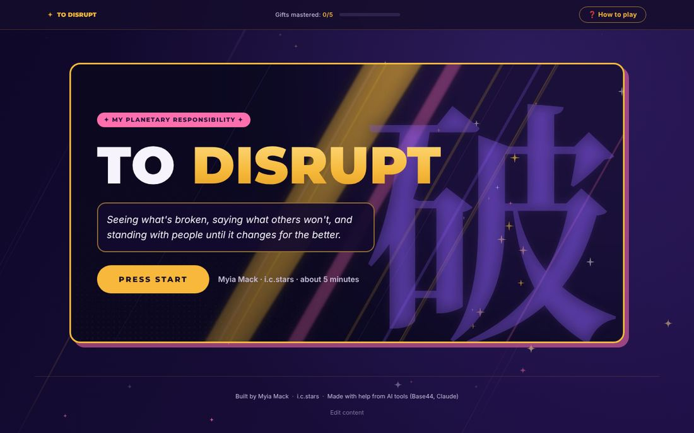
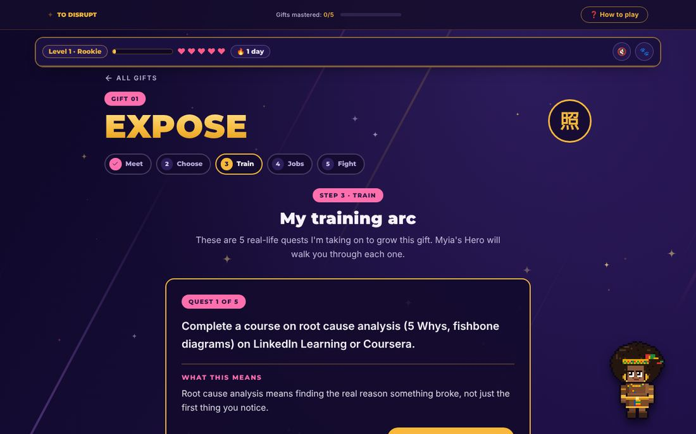
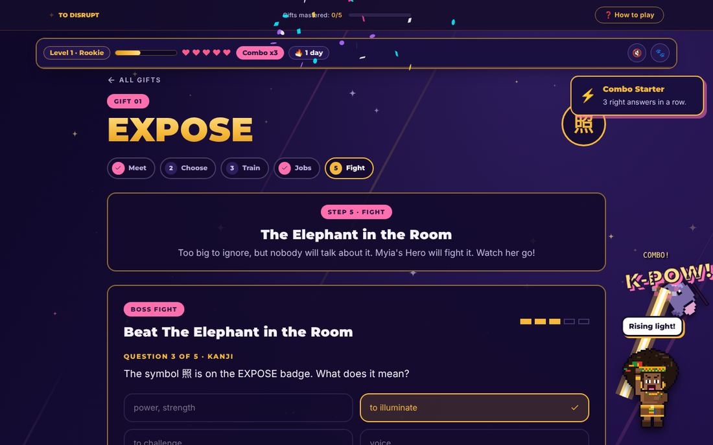

# TO DISRUPT: Choose Your Path

**My Planetary Responsibility, turned into an interactive game.**
Built by Myia Mack at i.c.stars.

▶️ **Play it:** https://myiamack.github.io/to_disrupt_demo/



## What it is

At i.c.stars, each intern defines their purpose in one word. Mine is **DISRUPT**:

> Seeing what's broken, saying what others won't, and standing with people until it changes for the better.

This game walks people through my purpose, my 5 gifts, the jobs each gift leads to, and the actions I'm taking to grow them. It plays like a short, fun walkthrough instead of a slideshow.

| Gift | Kanji | Battle cry | Jobs it unlocks |
|---|---|---|---|
| Expose | 照 | I see it. | QA Analyst · Community Researcher |
| Challenge | 挑 | I question it. | Process Improvement Consultant · Auditor |
| Advocate | 声 | I speak for others. | HR Specialist (Employee Relations) · Customer Success Manager |
| Empower | 力 | I pass the mic. | Learning & Development Specialist · Career Coach |
| Support | 支 | I stay through the change. | Project Manager · Social Worker |

## How it plays

Each gift is a chapter with 5 steps: **Meet → Choose → Train → Jobs → Fight**.

- **Meet:** my original illustration for the gift, plus tap-to-flip cards (meaning, how to say the kanji, battle cry).
- **Choose:** pick one of two ways to use the gift.
- **Train:** *Myia's Hero*, a pixel-art version of my character, walks you through 5 real-life quests one at a time and explains each one in plain words.
- **Jobs:** two careers the gift is great for.
- **Fight:** a 5-question boss quiz. Right answers are attacks, and the villain for each gift (like *The Elephant in the Room*) gets knocked around until it's beaten.




## Features

- **Myia's Hero:** a draggable mini pet with fighting moves, magic, a clone squad, idle animations (floating meditation, naps) and commentary.
- XP, ranks, combos, day streaks, achievements and optional sound effects.
- Read-aloud quests with a choice of voices.
- An animated "light in the dark" background that matches my Planetary Responsibility slides.
- A beginner guide, a 6th-grade reading level, and support for reduced motion.

## Built with

React, Vite, Tailwind CSS and HTML Canvas (all pixel art is drawn in code). Game text lives in [`src/data/content.json`](src/data/content.json).

## Run it on your computer

You need [Node.js](https://nodejs.org) 20 or newer.

```bash
npm install
npm run dev
```

Then open the address it prints (usually http://localhost:5173).

## Credits

Designed and built by Myia Mack (i.c.stars), with help from AI tools (Claude, Base44). Illustrations are my own Planetary Responsibility artwork.
